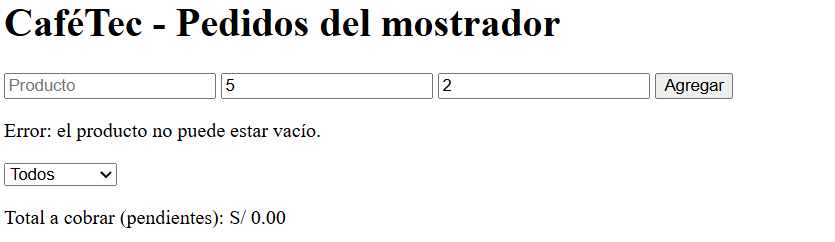
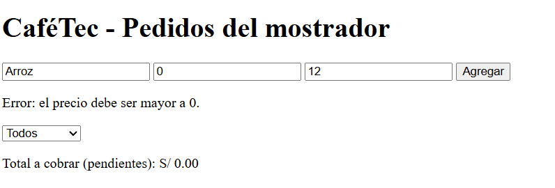
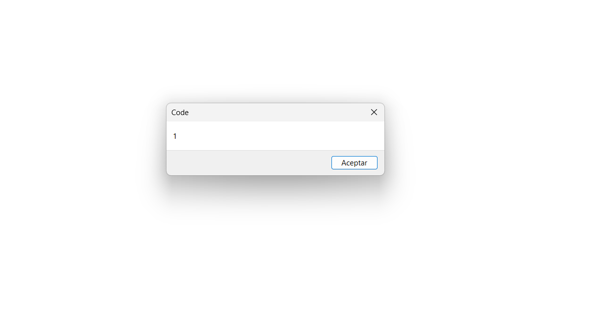
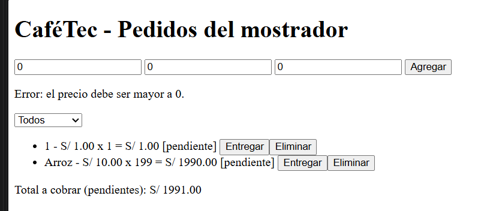
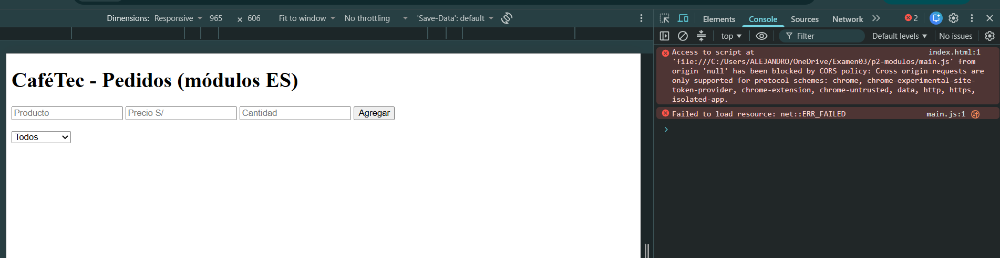
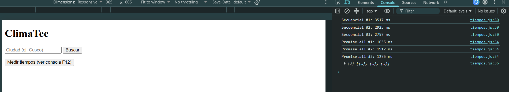
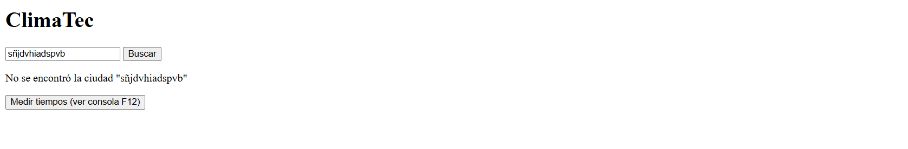

# evaluacion03-js · CaféTec y ClimaTec


Evaluación 03 de **Diseño de Interfaces de Programación Avanzado** (DD-106): DOM, ES6+ y Fetch API.

**Alumno:** Villacorta Layza Juan Alejandro

🔗 **GitHub Pages:** https://TU-USUARIO.github.io/evaluacion03-js/

## Tabla de contenidos

- [Pregunta 1 – DOM, eventos y objetos](#pregunta-1--dom-eventos-y-objetos)
- [Pregunta 2 – ES6+ y módulos](#pregunta-2--es6-y-módulos)
- [Pregunta 3 – Fetch y async/await](#pregunta-3--fetch-y-asyncawait)
- [Diagrama de la Pregunta 3](#diagrama-de-la-pregunta-3)
- [Bitácora de IA](#bitácora-de-ia)
- [Checklist](#checklist)
- [Conclusión](#conclusión)

---

## Pregunta 1 – DOM, eventos y objetos

Carpeta: [`p1-dom/`](p1-dom/)

### Tabla de eventos

| Elemento | Evento | Acción |
|---|---|---|
| `#form-pedido` | `submit` | `preventDefault()`, valida, crea el pedido, lo agrega al arreglo y llama a `render()` |
| `#filtro` | `change` | Vuelve a llamar a `render()` con el estado elegido |
| `#lista-pedidos` | `click` (delegado) | Con `closest("button")` y `data-id`, entrega o elimina el pedido y llama a `render()` |

### Modelo de pedido

```js
const pedido = {
  id: contadorId,
  producto: producto,
  precio: precio,
  cantidad: cantidad,
  estado: "pendiente",
  subtotal() {
    return this.precio * this.cantidad;
  },
  marcarEntregado() {
    this.estado = "entregado";
  }
};
```

### Validación (errores en `#mensaje`, sin `alert()`)

```js
if (producto === "") {
  mensaje.textContent = "Error: el producto no puede estar vacío.";
  return;
}
if (isNaN(precio) || precio <= 0) {
  mensaje.textContent = "Error: el precio debe ser mayor a 0.";
  return;
}
if (isNaN(cantidad) || cantidad < 0) {
  mensaje.textContent = "Error: la cantidad no puede ser negativa.";
  return;
}
```

### Delegación de eventos

```js
lista.addEventListener("click", function (event) {
  const boton = event.target.closest("button");
  if (boton === null || !lista.contains(boton)) {
    return;
  }
  const id = Number(boton.dataset.id);
 
});
```

**¿Por qué es mejor que un listener por botón?**

- Un solo listener atiende todos los botones. Con listeners por botón habría que crear uno por cada `<li>` en cada `render()`.
- Los botones se destruyen y se recrean en cada `render()`. Con delegación, los botones nuevos funcionan sin hacer nada más.
- Usa menos memoria, y `closest("button")` más `data-id` identifican el botón y el pedido sin guardar referencias.


### Capturas de funcionamiento




### Prueba de seguridad (XSS)

Producto de prueba: ``

| Método | Resultado |
|---|---|
| `innerHTML` | El navegador interpreta el texto como HTML, crea una ``, falla al cargar `x` y ejecuta `onerror`: aparece el `alert(1)`. |
| `textContent` / `createElement` | El texto se muestra literal; no se crea ninguna etiqueta ni se ejecuta código. |

**Riesgo:** XSS (Cross-Site Scripting). Si el dato viene de un usuario o de una API, un atacante podría ejecutar JavaScript en la página de otra persona.

**Decisión:** usar `createElement` + `textContent`, porque trata siempre el contenido como texto.

| Antes (innerHTML) | Después (textContent) |
|---|---|
|  |  |


---

## Pregunta 2 – ES6+ y módulos

Carpeta: [`p2-modulos/`](p2-modulos/)

### Cálculo manual

| Pedido | Cálculo | Subtotal |
|---|---|---|
| Café | 6 × 2 | 12.00 |
| Croissant | 4.5 × 0 | 0.00 |
| Jugo | 8 × 1 (sin cantidad vale 1) | 8.00 |
| **Suma** | | **20.00** |

IGV = 20 × 0.18 = 3.60 → **Total correcto = S/ 23.60**

El código antiguo devuelve **28.91**.

**Causa del error:** `pedidos[i].cantidad || 1`. El operador `||` trata el `0` como falso, así que el croissant cancelado pasa a valer 1 y suma 4.5 (más su IGV). La diferencia es 5.31. Además, `resumen()` del Jugo imprime `xundefined`.

### Código antiguo vs refactorizado

```js
// ANTES (error)
var cantidad = pedidos[i].cantidad || 1;
```

```js
// DESPUÉS (correcto)
const subtotal = pedidos.reduce(
  (acumulado, { precio, cantidad }) => acumulado + precio * (cantidad ?? 1),
  0
);
```

Resultado con el mismo arreglo: **23.6**.

### Clase y spread sin mutar

```js
marcarEntregado() {
  return new Pedido({ ...this, estado: "entregado" });
}

export const entregarPedido = (pedidos, id) =>
  pedidos.map((p) => (p.id === id ? p.marcarEntregado() : p));
```

### Características ES6+

| Característica ES6+ | Dónde la usé | Por qué |
|---|---|---|
| `const` / `let` | Todo el código | Evita `var` y su alcance de función |
| Funciones flecha | `calcularTotal`, `resumen`, `entregarPedido` | Sintaxis corta; no necesitan su propio `this` |
| Template literals | `resumen`, `ui.js` | Más legible que concatenar con `+` |
| Desestructuración con valores por defecto | Constructor de `Pedido` (`cantidad = 1`) | Valor por defecto sin `if` |
| `reduce()` | `calcularTotal` | Acumula el total en una expresión |
| `?.` | `cliente?.nombre` | No falla si no hay `cliente` |
| `??` | `cantidad ?? 1` | Respeta el 0, que es el error de `\|\|` |
| `class` | `Pedido` | Modelo con `subtotal()` y `marcarEntregado()` |
| Spread `...` | `marcarEntregado`, `agregarPedido` | Actualiza sin mutar |

### Módulos

- `pedidos.js`: clase y cálculos
- `ui.js`: funciones del DOM
- `main.js`: punto de entrada, cargado con `<script type="module">`

**Export nombrado vs default:**

- **Nombrado** para funciones y constantes (`calcularTotal`, `IGV`, `renderLista`): un módulo puede exportar varias, el nombre es obligatorio al importar y el editor autocompleta.
- **Default** solo para `Pedido`, porque `pedidos.js` gira alrededor de una clase principal.

### Error con `file://` vs Live Server

### Uso de IA en `render()`

**IA usada:** Claude. Le pedí que generara la función `render()` del gestor de pedidos.

**¿Qué propuso?** Una función que limpia la lista con `lista.textContent = ""`, recorre el arreglo `pedidos` y construye cada elemento con `createElement`, `textContent` y `dataset` (`data-id`, `data-accion`). Al final recalcula el total con `subtotal()` y lo muestra en `#total`.

**Revisión que hice:**

| Pregunta de la evaluación | Resultado |
|---|---|
| ¿Usaba `innerHTML` con datos del usuario? | No. Todo el texto del usuario se inserta con `textContent`. |
| ¿Recalculaba bien el total? | Sí. Recorre el arreglo completo en cada `render()`, no acumula valores viejos. Lo comprobé agregando, entregando y eliminando pedidos y comparando con mi cálculo a mano. |
| ¿Resiste la prueba XSS? | Sí. Con `` el texto se muestra literal (ver captura "Después"). |

**Decisiones:**

| Parte de la propuesta | Decisión | Por qué |
|---|---|---|
| `createElement` + `textContent` | **Aceptó** | Con una versión de prueba que usa `innerHTML` (`seguridad-antes.html`) sí se ejecutó el `alert(1)`; con esta no |
| Botones con `data-id` y `data-accion` | **Aceptó** | Permiten usar un solo listener en `#lista-pedidos` con `closest("button")` |
| Total solo de pedidos pendientes | **Aceptó** | Decidí que "total a cobrar" excluye lo ya entregado; el enunciado no lo especifica |
| Validación nativa del navegador (`min="0"`) | **Corrigió** | Bloqueaba el envío y los errores no llegaban a `#mensaje`; agregué `novalidate` al formulario |

La IA no usó `innerHTML` con datos del usuario, así que no hubo que corregir ese riesgo en la propuesta. La prueba XSS la hice con una versión vulnerable aparte para comparar.



**Por qué ocurre:** los navegadores bloquean los módulos ES (`type="module"`) cargados desde `file://` (origen `null`, política CORS).

**Solución:** servir los archivos por HTTP, por ejemplo con Live Server.

### Uso de IA en la refactorización

**IA usada:** Claude. Le pedí la refactorización completa del código antiguo con ES6+ y módulos.

**¿Mantuvo el error de `||`?** No. Lo corrigió: reemplazó `pedidos[i].cantidad || 1` por `cantidad ?? 1` dentro de `reduce()`. Con el arreglo de prueba el resultado pasó de **28.91** (código antiguo) a **23.60** (código refactorizado), que coincide con mi cálculo manual.

**Otras decisiones de la IA y qué hice con cada una:**

| Propuesta de la IA | Decisión | Por qué |
|---|---|---|
| Usar `??` en vez de `\|\|` para la cantidad | **Aceptó** | Con `\|\|` el 0 se convierte en 1; comprobé que el total sale 23.60 y no 28.91 |
| Corregir también `resumen()` con `cantidad ?? 1` | **Aceptó** | El código antiguo imprimía `Jugo xundefined` cuando no había cantidad |
| `cliente?.nombre ?? "Anónimo"` | **Aceptó** | Evita el error si el pedido no tiene `cliente` |
| `marcarEntregado()` devuelve un `Pedido` nuevo con spread | **Aceptó** | Actualiza el arreglo sin mutarlo; comprobé que el arreglo original sigue "pendiente" |
| `export default` solo
## Pregunta 3 – Fetch y async/await

Carpeta: [`p3-api/`](p3-api/)

### Endpoints (según la documentación oficial de Open-Meteo)

| Endpoint | Parámetros que usa | Campos de la respuesta que necesita |
|---|---|---|
| `https://geocoding-api.open-meteo.com/v1/search` | `name`, `count=1`, `language=es` | `results[0].name`, `admin1`, `latitude`, `longitude` |
| `https://api.open-meteo.com/v1/forecast` | `latitude`, `longitude`, `current=temperature_2m,wind_speed_10m` | `current.temperature_2m`, `current.wind_speed_10m` |

### Manejo de errores

```js
try {
  const c = await climaDeCiudad(nombre);
  resultado.textContent = `${c.ciudad} (${c.region ?? "sin región"}): ${c.temperatura} °C`;
} catch (error) {
  if (error instanceof TypeError) {
    resultado.textContent = "Sin conexión: revisa tu internet.";
  } else {
    resultado.textContent = error.message;
  }
} finally {
  boton.disabled = false;
}
```

**¿Por qué `fetch` no lanza error ante un 404 o 500?** `fetch` solo rechaza la promesa cuando falla la red (sin conexión, DNS, CORS). Un 404 o 500 es una respuesta HTTP válida que llegó bien, por eso hay que revisar `response.ok`.


### Medición de Tiempos: Secuencial vs. Promise.all

Se realizaron 3 mediciones del tiempo de ejecución utilizando `performance.now()` para comparar las solicitudes en secuencia (`await` uno tras otro) frente a las solicitudes en paralelo con `Promise.all`:

| Forma | Medición 1 | Medición 2 | Medición 3 | Promedio |
| :--- | :---: | :---: | :---: | :---: |
| **Secuencial (3 await)** | 3517 ms | 2925 ms | 2757 ms | **3066 ms** |
| **Promise.all** | 1635 ms | 1912 ms | 1275 ms | **1607 ms** |

---

### Conclusión sobre el Rendimiento

* **Eficiencia en Red:** La ejecución en paralelo con `Promise.all` fue aproximadamente un **47.6% más rápida** (reduciendo el tiempo promedio de **3066 ms** a **1607 ms**).
* **Causa Técnica:** En el enfoque **secuencial**, el navegador debe esperar a que finalice por completo la petición HTTP de una ciudad antes de iniciar la siguiente, sumando la latencia de cada respuesta. En cambio, **`Promise.all`** dispara todas las peticiones a la API de Open-Meteo de forma simultánea, por lo que el tiempo total depende principalmente de la respuesta más lenta y no de la suma de todas ellas.
* **Recomendación:** Conviene utilizar llamadas concurrentes cuando las peticiones a la API sean independientes entre sí.



### `Promise.all` vs `Promise.allSettled`

- `Promise.all` se rechaza en cuanto una falla y se pierden los resultados de las demás.
- `Promise.allSettled` espera a todas y devuelve `fulfilled` o `rejected` por cada una.

**Decisión:** `allSettled` para este widget. Si "Xyzabc" falla, Lima y Cusco igual se muestran y el error aparece solo en esa ciudad. Se usaría `all` solo si el resultado fuera inútil sin alguna de las ciudades.



### Uso de IA en el widget

**IA usada:** Claude. Le pedí el código del widget ClimaTec con `async/await`.

**Verificación contra la documentación oficial de Open-Meteo:** revisé cada parámetro y campo que usa el código.

| Elemento del código | Endpoint | ¿Existe en la documentación? | Resultado |
|---|---|---|---|
| `name` | Geocodificación | Sí (obligatorio) | Correcto |
| `count=1` | Geocodificación | Sí (por defecto 10, máximo 100) | Correcto |
| `language=es` | Geocodificación | Sí (por defecto `en`) | Correcto |
| `results[0].name` | Geocodificación | Sí | Correcto |
| `results[0].admin1` | Geocodificación | Sí | Correcto (en mi prueba devolvió "Departamento de Cusco") |
| `results[0].latitude` / `longitude` | Geocodificación | Sí | Correcto |
| `latitude`, `longitude` | Clima | Sí | Correcto |
| `current=temperature_2m,wind_speed_10m` | Clima | Sí (°C y km/h por defecto) | Correcto |
| `current.temperature_2m`, `current.wind_speed_10m` | Clima | Sí | Correcto |

**Parámetros o campos inexistentes, mal escritos u obsoletos:** no encontré ninguno en este código.

**Un punto que la documentación no aclara:** la página de geocodificación no describe qué devuelve la API cuando no hay coincidencias (solo dice que las búsquedas vacías o de un carácter no devuelven resultados). Por eso el código no asume nada y revisa `!datos.results`. Lo comprobé buscando "Xyzabc" y [TÚ: escribe lo que realmente viste en pantalla y en la pestaña Network].

**Qué decidí yo y no la IA:**
- Usar `Promise.allSettled` en vez de `Promise.all`.
- Hacer las mediciones de tiempo con mis propias pruebas en el navegador.

---